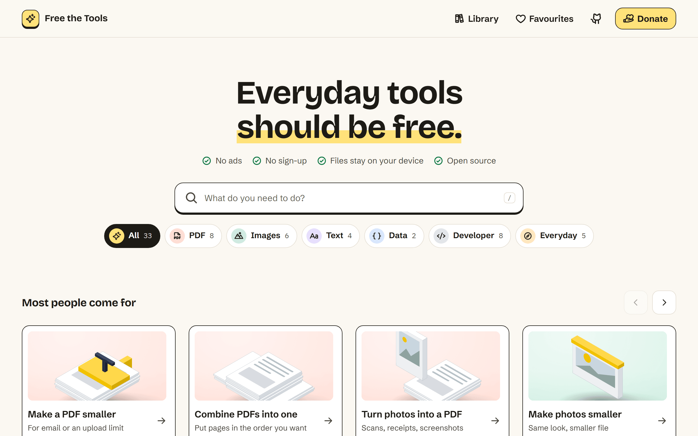

<p align="center">
  <a href="https://freethetools.com"></a>
</p>

<h1 align="center">Free the Tools</h1>

<p align="center"><strong>Everyday tools should be free.</strong></p>

<p align="center">
  Free tools for PDFs, images, text, data and more. They run in your browser, so your files stay on your device.
</p>

<p align="center">
  <a href="https://freethetools.com">Website</a> ·
  <a href="https://freethetools.com/ai/">Use with AI</a> ·
  <a href="https://github.com/sapience-design/freethetools/issues/new?template=tool_request.yml">Request a tool</a> ·
  <a href="CONTRIBUTING.md">Contribute</a> ·
  <a href="https://freethetools.com/support/">Donate</a>
</p>

<p align="center">

[](https://github.com/sapience-design/freethetools/actions/workflows/ci.yml)
[](https://scorecard.dev/viewer/?uri=github.com/sapience-design/freethetools)
[](LICENSE)
[](https://www.npmjs.com/package/freethetools)

</p>

<a href="https://freethetools.com">
  <picture>
    <source media="(prefers-color-scheme: dark)" srcset="docs/images/home-dark.png">
    
  </picture>
</a>

Everyday tools should *not* cost money.<br>
They should *not* come with ads.<br>
They should *not* put your files at risk.<br>
They should *not* be hard to find.<br>
So here they are: one place, every tool, free for everyone. Help us build the next one.

Free the Tools is a [Sapience Design](https://sapience.design) initiative, built in the open with anyone who wants to help.

## Why Free the Tools

- **Free, with no limits.** No ads, no accounts, no watermarks.
- **Your files stay on your device.** A Content Security Policy stops every page from sending data to another server, and tests fail if a tool tries. The site keeps only anonymous daily totals ([what's counted](https://freethetools.com/stats/)).
- **Works offline** once a tool has loaded.
- **Open source** under AGPL-3.0.
- **Works with AI assistants** through the [`freethetools`](https://www.npmjs.com/package/freethetools) package.
- **Available in** English, Norwegian, Spanish and Russian.

## Tools

<!-- site-tools:start: written by scripts/tool-table.mjs -->
| Group | Tools |
|---|---|
| PDF | [Make a PDF smaller](https://freethetools.com/pdf/compress/) · [Fill in a PDF form](https://freethetools.com/pdf/fill-form/) · [Turn photos into a PDF](https://freethetools.com/pdf/images-to-pdf/) · [Combine PDFs into one](https://freethetools.com/pdf/merge/) · [Save PDF pages as pictures](https://freethetools.com/pdf/to-images/) · [Lock a PDF with a password](https://freethetools.com/pdf/protect/) · [Turn PDF pages the right way up](https://freethetools.com/pdf/rotate/) · [Split a PDF into parts](https://freethetools.com/pdf/split/) · [Take the lock off a PDF](https://freethetools.com/pdf/unlock/) · [View, fill in and sign a PDF](https://freethetools.com/pdf/edit/) |
| Images | [Make photos smaller](https://freethetools.com/images/compress/) · [Change a photo's type](https://freethetools.com/images/convert/) · [Open iPhone photos anywhere](https://freethetools.com/images/heic-to-jpg/) · [Turn a picture into an SVG drawing](https://freethetools.com/images/to-svg/) · [Remove location from photos](https://freethetools.com/images/remove-location/) · [Resize photos](https://freethetools.com/images/resize/) · [Turn a video into a GIF](https://freethetools.com/images/video-to-gif/) |
| Text | [Change text to UPPER or lower case](https://freethetools.com/text/case-converter/) · [Turn Markdown into HTML](https://freethetools.com/text/markdown-to-html/) · [Compare two texts](https://freethetools.com/text/text-diff/) · [Count words](https://freethetools.com/text/word-counter/) |
| Data | [Turn a spreadsheet into JSON](https://freethetools.com/data/csv-to-json/) · [Tidy up and check JSON](https://freethetools.com/data/json-formatter/) |
| Developer | [Encode or decode Base64](https://freethetools.com/developer/base64/) · [Make a fingerprint (hash)](https://freethetools.com/developer/hash-generator/) · [Look inside a login token](https://freethetools.com/developer/jwt-decoder/) · [Make a strong password](https://freethetools.com/developer/password-generator/) · [Make a QR code](https://freethetools.com/developer/qr-code-maker/) · [Test a search pattern](https://freethetools.com/developer/regex-tester/) · [Encode or decode a web address](https://freethetools.com/developer/url-encode/) · [Make unique IDs](https://freethetools.com/developer/uuid-generator/) |
| Everyday | [Convert a colour between formats](https://freethetools.com/everyday/colour-converter/) · [Convert any file](https://freethetools.com/everyday/file-converter/) · [Convert time zones](https://freethetools.com/everyday/time-zone-converter/) · [Convert units](https://freethetools.com/everyday/unit-converter/) · [Convert a Unix timestamp to a date](https://freethetools.com/everyday/unix-timestamp/) |
<!-- site-tools:end -->

People ask for tools that do not exist yet. Accepted requests are [open requests](https://github.com/sapience-design/freethetools/issues?q=is%3Aissue+is%3Aopen+label%3Awanted), and anyone can [suggest a tool](https://github.com/sapience-design/freethetools/issues/new?template=tool_request.yml).

## Use it

Open [freethetools.com](https://freethetools.com) and pick a tool. There is nothing to install and no account to make.

Developers and AI agents can read the catalogue at [`/api/tools.json`](https://freethetools.com/api/tools.json) (described in [`openapi.yaml`](openapi.yaml)) or [`/llms.txt`](https://freethetools.com/llms.txt).

## Use it with AI

Claude, Cursor and other AI assistants can use the tools instead of installing software such as Ghostscript, ImageMagick or a Python package, and without sending files to a server. It is free, with no account or login. Files stay on the device either way. There are two channels, and both use one definition per tool ([ADR 0008](docs/adr/0008-tools-for-ai-agents.md)).

| Channel | For | Setup |
|---|---|---|
| The `freethetools` npm package, an MCP server on your computer | Claude Code, Claude Desktop, Cursor and other MCP clients | One step: Claude Code plugin (`/plugin marketplace add sapience-design/freethetools`, then `/plugin install freethetools@freethetools`), Gemini CLI (`gemini extensions install https://github.com/sapience-design/freethetools`), or the Add to Cursor and Add to VS Code buttons on [freethetools.com/ai](https://freethetools.com/ai/). By hand: `claude mcp add freethetools -- npx -y freethetools mcp` |
| WebMCP on each tool page | AI agents inside a browser | None. Chrome and Edge support it in origin trials; other browsers ignore it. |

The package is published on [npm](https://www.npmjs.com/package/freethetools) and listed in the official [MCP Registry](https://registry.modelcontextprotocol.io/) as `io.github.sapience-design/freethetools`. It reads files by path, saves results in a `freethetools` folder in your home folder, and records every job in `library.jsonl`. It also has a command line for agents without MCP: `npx -y freethetools run <tool> '<json>'`. Setup for each client is in [docs/how-to/use-with-ai.md](docs/how-to/use-with-ai.md). The package source is in [packages/freethetools](packages/freethetools). There is no hosted MCP server, because the files would have to be uploaded.

## Why in the browser, and how far it goes

Services such as iLovePDF or CloudConvert process files on their own servers. Every file costs something to handle there, so free plans usually come with limits. Here the visitor's device does the work and the pages are static files, so a million visitors cost about what one does. That is why "free, with no limits" is a promise we can keep.

A browser can do more than most people expect. Ghostscript and qpdf run inside the page as WebAssembly, alongside pdf-lib, pdf.js and the image codecs, and the tools keep working offline once opened. Text recognition, translation and speech-to-text can run the same way. The gap between "needs a server" and "runs on your device" shrinks every year, and the tool list grows with it. Jobs a browser cannot do yet wait; we do not add a server to get there.

## Request a tool

[Open a tool request](https://github.com/sapience-design/freethetools/issues/new?template=tool_request.yml). Vote for existing requests with a 👍. Requests a maintainer accepts are labelled `wanted` and show on the site as open requests.

## Build a tool

Most tools take an afternoon. The [contributor guide](CONTRIBUTING.md) walks you through it:

```sh
git clone https://github.com/sapience-design/freethetools.git
cd freethetools
npm install
npm run new-tool -- text word-counter "Word Counter"
npm run dev          # http://localhost:4321/text/word-counter/
```

## How it works

| | |
|---|---|
| `tools/<group>/<tool>/` | One folder per tool: `tool.json` (name, search text, specs, questions), `Tool.astro` (the interface), `core.js` (the logic) and tests |
| `src/` | The site: layout, home and group pages, tool pages, API and search files, all built from the tool folders |
| `astro.config.mjs` | The Content Security Policy that keeps every page on its own origin |
| `worker/`, `migrations/` | The only server code: anonymous usage totals at `/api/stats/*`, stored in Cloudflare D1 |
| `packages/freethetools/` | The npm package: an MCP server and command line that run the tools on your computer. Build it with `npm run build:package` |
| `e2e/`, `tests/` | Browser tests and checks on the built site |
| `docs/` | Tutorials, how-to guides, reference and design decisions |

The site is static [Astro](https://astro.build) plus one small Worker for anonymous totals, hosted on Cloudflare Workers, which builds and deploys every merge to `main`. Read [docs/explanation/architecture.md](docs/explanation/architecture.md) for the reasoning.

## Support

Free the Tools has no ads and no paywall. If it saves you time, you can [donate or sponsor a tool](https://freethetools.com/support/). Money never buys features or placement.

## Project

- [Contributing](CONTRIBUTING.md) · [Code of conduct](CODE_OF_CONDUCT.md) · [Governance](GOVERNANCE.md)
- [Security policy](SECURITY.md): report vulnerabilities privately, never in a public issue
- [Changelog](CHANGELOG.md)

## Licence

Code: [AGPL-3.0](LICENSE), copyright © Sapience Design and contributors. Third-party parts are listed in [NOTICE](NOTICE).

"Free the Tools" and the Sapience name and logo are trademarks of Sapience Design and are not covered by the code licence. You are welcome to fork the code under a different name. See [TRADEMARKS.md](TRADEMARKS.md).
